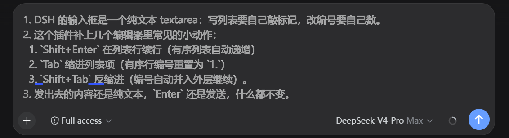

# dsh-mdbox

DeepSeek Harness (DSH) Web 输入框的 Markdown 编辑辅助插件。



## Overview

DSH 的输入框是一个富文本编辑器（引用 chip 是原子节点）：写列表要自己敲标记，改编号要自己数。这个插件补上几个编辑器里常见的小动作：`Shift+Enter` 在列表行续行（有序列表自动递增），`Tab` 缩进列表项（有序行编号重置为 `1.`），`Shift+Tab` 反缩进（编号自动并入外层继续）。发出去的内容还是纯文本，`Enter` 还是发送，什么都不变。

如果你经常在对话里写清单、步骤和带缩进的提纲，会用到它。

## Compatibility

| 插件版本 | DSH 版本 | 输入面 | 状态 |
| --- | --- | --- | --- |
| 0.2.x | `@deepseek-ai/dsh-*` 0.2.0-rc.2 | Lexical contenteditable | 当前，最后验证 2026-10-14 |
| 0.1.x | `@deepseek-ai/dsh-*` 0.1.0-rc.6 | `<textarea>` | 已不再适配 |

DSH 0.2.0 把输入框从 `<textarea>` 换成了 Lexical 富文本编辑器（引用 chip 是原子 decorator 节点）。0.1.x 按 `TEXTAREA` 匹配输入框，在这套输入面上匹配不到任何元素，插件会**静默失效**（装在插件列表里但毫无反应）。0.2.0 起插件跟着换了对接面。

插件只依赖两样对外可见的东西，不 import DSH 内部模块：

- **DOM 锚点**：输入框根元素 `[data-composer-input]`（位于卡片 `[data-composer-card]` 内，`role="textbox"`、`aria-multiline="true"`）；
- **编辑器实例**：输入框根元素上的 `__lexicalEditor`（Lexical 自己在 `contentEditable` 切换时挂载/删除）。

草稿文本按 DSH 自己的 detect 投影读：顶层段落之间算一个 `\n`，原子节点（引用 chip 等）折叠成一个 `U+FFFC`。编辑只落到需要改的片段上——不重建段落、不切开 chip，每次按键是一次 `editor.update()`（单次撤销事务）。

纯浏览器端插件，没有宿主半部，没有服务注入。插件不触碰 DSH 的 backdrop 渲染层（输入框可见文字由该层渲染），只做纯文本按键行为。

DSH 大版本如果再次调整输入面，需要跟着改，改动集中在 `lib/client.js` 的「文档投影」和「接入」两段：锚点变了改 `composerInput()`，编辑器实例位置变了改 `getEditor()`，段落/原子节点模型变了改 `nodeText()` / `projectDraft()`。

## Install

装进官方 web profile（自带 dsh-base + dsh-web-app 两层）：

```powershell
dsh plugin --profile web add github:chi-hong22/dsh-mdbox
# 或本地 checkout：
dsh plugin --profile web add D:/path/to/dsh-mdbox
```

仓库包含构建产物（`lib/` 已提交，纯 JS 没有构建步骤），安装后无需另外构建。`dsh plugin add` 会写入依赖并把本包加进 profile 的 bundles 列表，挂载行来自本包自带的 `cordis.patch.yml`，不需要手动改任何 profile 文件。

验证安装：

```powershell
dsh --profile web --dump-config | Select-String ui-mdbox
```

输出里有下面几行就是装上了：

```yaml
# == @chi-hong22/dsh-mdbox
- id: ui-mdbox
  name: '@chi-hong22/dsh-mdbox'
```

重启 DSH，插件出现在 设置 → 插件 里。

手动安装只留给旧版本或调试：把本包作为 workspace/link 依赖装上，再在 profile 的 `cordis.patch.yml` 里手写一行 `insert: [{ id: ui-mdbox, name: '@chi-hong22/dsh-mdbox' }]`。别和 bundle 通道并用，同一行挂两次会双重加载。

## Uninstall

```powershell
dsh plugin --profile web remove @chi-hong22/dsh-mdbox
```

执行后重启 DSH 生效。

如果你当时是手动安装的（旧路径）：删掉 profile `cordis.patch.yml` 里的 `ui-mdbox` 行、`package.json` 里的依赖、`node_modules` 里的链接，然后重启。

插件不写磁盘，删掉就是删干净了。升级：`link:` 安装的直接更新仓库目录内容，重启生效；npm 安装的用 `dsh plugin --profile web add @chi-hong22/dsh-mdbox@<version>`。

## Quick start

没有插件级配置项。

```text
- 第一项            # Shift+Enter → 续行 "- "
  1. 子步骤        # Tab 缩进（编号重置为 1.）；Shift+Enter → "2. "；Shift+Tab 反缩进（并入外层续号）
```

自动重编号：已有 `1. a` / `2. b` 两行，在 `1. a` 行尾按 `Shift+Enter` 插入新行：

```text
1. a
2.          ← 新插入的空列表项
3. b        ← 原 2. b 自动变为 3. b
```

空列表项上再按 `Shift+Enter` 退出列表（删掉行首标记）。普通行 `Enter` 发送，`Shift+Enter` 换行，`Ctrl+Enter` 强制发送。

缩进与反缩进（光标在列表行内按 `Tab` / `Shift+Tab`）：

- `Tab`：整行缩进 2 空格；有序行编号重置为 `1.`（保留 `.` / `)` 风格），同层后续行自动递增；
- `Shift+Tab`：删掉最多 2 空格缩进；有序行编号自动并入外层块继续（外层最大编号 +1）；若被移出的是块首，其原缩进层剩余块从 `1.` 重新起号；
- 无序行缩进/反缩进只动缩进，标记不变。

## Configuration

没有配置项，也没有环境变量。行为常量在 `lib/client.js` 顶部：

- 列表标记：`-` `*` `+`、`1.` `1)`。有序块内编号强制连续，块首保持你写的起始值；各缩进层的块独立记账，嵌套列表结束后回到外层继续递增；
- 缩进宽度：2 空格（Tab 缩进时有序行编号重置为 `1.`，Shift+Tab 反缩进后编号并入外层续号）；
- `MAX_RENUMBER = 20000`：草稿超过 20000 字符后跳过兜底重排，按键行为不受影响；
- 自动重编号跳过代码围栏（``` / ~~~）里的行。

## Permissions & data

不碰文件、网络、凭据和用户数据；没有宿主半部，不上传也不存储任何内容。只读写当前会话输入框的草稿（浏览器内存内），只做按键行为，不修改输入框之外的任何 DOM。副作用都挂在 Cordis fiber 上，插件停用即还原。

## Troubleshooting

| 现象 | 排查 |
| --- | --- |
| 重启后插件列表没有 dsh-mdbox | 检查 patch 行 `name` 与包 `name` 是否一致、`node_modules` 链接是否指向有效目录、YAML 缩进是否正确 |
| 插件在列表但功能不生效 | 确认焦点在输入框；IME 组合输入期间插件会主动让位（先确认候选词上屏）；打开浏览器控制台看 `dsh-mdbox` 相关报错 |
| 升级 DSH 后整个插件失效（毫无反应） | 多半是输入面对不上：在浏览器控制台执行 `document.querySelector("[data-composer-input]")`，返回 `null` 说明锚点变了，按上面 Compatibility 一节改 `lib/client.js` |
| 想回滚 | 删除 patch 条目并重启；改动都在 profile 目录，插件没有持久化数据 |

日志：插件不写日志文件；运行期错误在浏览器开发者工具 Console 里。

## Development

没有构建步骤：直接改 `lib/client.js`（浏览器半部）和 `lib/index.js`（宿主半部空实现），重启 DSH 生效。

```
├── package.json       # 包声明（dsh.bundle.patch + dsh.client；peerDeps 仅 cordis）
├── cordis.patch.yml   # bundle patch：insert ui-mdbox 行（官方挂载通道）
├── LICENSE
└── lib
    ├── index.js     # 宿主半部（空实现，纯 UI 插件的 Loader 约定）
    └── client.js    # 浏览器半部（__ModuleLoader__ 模块格式）
```

`lib/client.js` 分四层，改行为时按层定位：常量 → 纯文本层（列表标记、缩进、重编号，只吃字符串）→ 文档投影层（Lexical 节点树 ↔ detect 文本坐标）→ 写入层（`editor.update()` 内落地 edits）→ 接入层（DOM 锚点、编辑器实例、键盘监听）。

手动验证清单（需要浏览器）：列表续行/递增、中间插入后自动重编号、空项退出、Tab 缩进（编号重置为 1.）/ Shift+Tab 反缩进（并入外层续号）、IME 组合输入让位、`Ctrl+Z` 撤销、行内引用 chip 不被编辑切开。

纯函数回归验证（Node，不需要浏览器，覆盖纯文本层与文档投影层）：

```powershell
node .scratch/editor-fixes/verify.mjs
```

脚本直接读 `lib/client.js`、切出 factory 体求值，再对内部函数断言，所以不需要构建，也不需要测试框架。Lexical 一侧（`editor.update()` 与节点树改动）没有自动化测试，靠上面的浏览器清单人工验证。

发布到 npm 时，把 `name` 换成你自己有权控制的 scope，不要占用 `@deepseek-ai/*` 官方保留命名空间；并在 package.json 补上 `repository` 字段。

## License & security

许可证：MIT（见 LICENSE）。

安全问题走 GitHub Issue；涉及未公开细节的不要写进公开 issue，先通过仓库所有者的 GitHub 主页私信联系。


